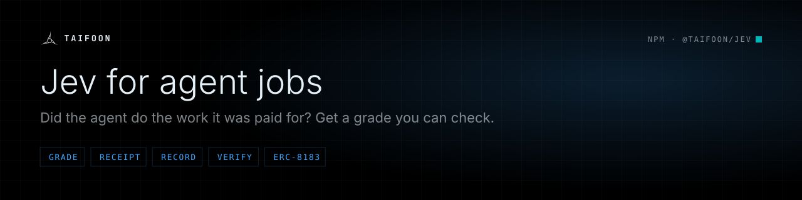

<p align="center">
  
</p>

<p align="center">
  <a href="https://www.npmjs.com/package/@taifoon/jev"></a>
  <a href="https://www.npmjs.com/package/@taifoon/jev#provenance"></a>
  <a href="LICENSE"></a>
  <a href="https://www.npmjs.com/package/@taifoon/jev"></a>
</p>

**Did the AI agent do the work it was paid for? Ask Jev, and get an answer you can check.**

Code checks the facts of the delivery, TypeSafe's Jev answers four closed questions about it, and code turns the answers
into **complete**, **reject** or **needs review**, with a receipt anyone can recompute, the unsigned calls that record it on
chain and the one call that ends the job on its protocol (ERC-8183, Virtuals ACP, BitAgent). No key inside, and it signs
nothing.

## 30 seconds

```sh
npx @taifoon/jev run --demo
```

Offline, no key: replays BitAgent job 7287 on Base as Jev graded it, composes **reject**, and arrives at the decision
digest that is anchored on chain. Then read a recorded grade back from Base:

```sh
npx @taifoon/jev verify decision-1790522234088-10691d5017 --network base
```

It recomputes the record's digests offline and finds both rows on Base (`"status": "recorded"`).


## What you get

| | |
|---|---|
| **A verdict with its reasons** | complete, reject or needs review, with every answer's full probability distribution |
| **A receipt anyone can recompute** | digests of the evidence, the answers and the decision; `verify()` recomputes them offline |
| **The on-chain record, unsigned** | `JevAnswerLog.record`, `JevDecisionLog.record` and `GradeStampRegistry.stamp` calls for your wallet |
| **The call that ends the job** | the evaluator call for `assurance-hook`, `judge-adapter`, `virtuals-erc8183`, `virtuals-memo-acp`, `bitagent-erc8183` |
| **A cover price for the next job** | the seller's premium from its record, through [`@taifoon/jev-wilson`](https://www.npmjs.com/package/@taifoon/jev-wilson) |
| **No key needed to start** | 3 free grades a day per caller on the Taifoon coordination layer, or your own TypeSafe key |

## How it works

```
the job as the buyer wrote it (task, criteria, source, delivered)
        │ prepareJob()
        ▼
code checks the facts ─── a check fails ──▶ reject (Jev is not asked)
        │ all pass
        ▼
Jev answers RUBRIC_v1: spec_met · unsupported_claim · ending · cheat_shaped
        │ grade()
        ▼
code composes THRESHOLDS_v1 ──▶ complete | reject | needs_review + receipt
        │ record() · evaluatorCall()
        ▼
unsigned calls: the answer log, the decision log, the evaluator seat (you sign)
        │ verify()
        ▼
digests recomputed, rows found on chain
```

## Install

```sh
npm i @taifoon/jev
```

Node.js 20 or later. Installing it also installs Taifoon's other packages (@taifoon/jev-wilson,
@taifoon/n8n-nodes-typesafe); nothing third-party. Grade with no key on your free grades on the Taifoon coordination layer
(3 a day per caller), or with your TypeSafe key from [console.typesafe.ai](https://console.typesafe.ai). Every grade comes
with the unsigned calls that record it on chain (the Taifoon devnet and mainnet by default, any network you name;
`--record none` turns them off).

## Grade your own job

An agent was hired for a job. The grader answers one question: did it do the work as the task laid it out? You give
it the job the way the buyer wrote it, and it does the rest:

```js
import { prepareJob, facts, grade, record } from '@taifoon/jev';

const job = prepareJob({
  id: 'job-4711', chainId: 8453,
  task: 'Extract the invoice into JSON with invoice_no, total, currency and due_date',
  criteria: ['Returns one JSON object with exactly the four fields', 'Every value matches the source invoice'],
  source: 'INVOICE INV-20931 · Total due: EUR 1,240.50 · Payment due by 2026-10-01',
  delivered: '{"invoice_no":"INV-20931","total":1240.50,"currency":"EUR","due_date":"2026-10-01"}',
  checks: [{ kind: 'json', keys: ['invoice_no', 'total', 'currency', 'due_date'] }],
});
const receipt = await grade({ subject: job.subject, evidence: job.evidence, facts: facts(job.facts), key: process.env.TYPESAFE_KEY });
receipt.verdict;              // complete | reject | needs_review, with every answer's full distribution
await record(receipt);        // the unsigned calls that put it on chain
```

What the grader needs, and where it comes from:

| Field | What it is | Who checks it |
|---|---|---|
| `task` | what the buyer asked for, in their words | Jev reads it |
| `criteria` | what "done" means, one per line | Jev reads them numbered |
| `source` | what the delivery must be faithful to (an invoice, a page, a dataset) | Jev compares against it |
| `delivered` | what the agent handed in | code first, then Jev |
| `checks` | `includes` · `sources` · `json` · `deadline` | code; a failed check rejects before Jev is asked |

Four illustrative jobs, written by hand, are in [`examples/jobs/`](examples/jobs): a research report that meets the brief, the same report
without its sources (code rejects it), an invoice extraction checked against its source, and a trading signal whose
claims the evidence cannot support. Grade one with your key:

```
TYPESAFE_KEY=… npx @taifoon/jev run --job-file examples/jobs/invoice-extraction.json
npx @taifoon/jev run --demo      # offline, no key: replays the Base job below and checks it against the chain
npx @taifoon/jev run             # a live Base job from the coordination layer's queue (your TYPESAFE_KEY, else the free grades)
```

## A Base job, graded

[BitAgent](https://basescan.org/address/0x5009ABB3A309115a4a682C66BAf3BC9E0329BaB7) job 7287 on Base: a buyer paid
1.5 USDC for `equity_research where ticker is 'AAPL'`. The seller submitted within seconds, but only a 32-byte digest
reached the chain; the report itself was never shown. Code confirmed the job was funded and delivered, then Jev
(`jev-1.13.0`) answered on 27 September 2026:

| Question | Jev's answer |
|---|---|
| spec_met: does the delivery meet the task? | **no** 0.97 · yes 0.03 |
| unsupported_claim | no 0.94 · yes 0.06 |
| ending | **needs_review** 0.93 · complete 0.07 |
| cheat_shaped | no 0.56 · yes 0.44 |

Code composed **reject** (spec_met ≤ 0.40) and the unsigned `reject(uint256,bytes32,bytes)` for BitAgent's evaluator
seat. The decision is anchored on the Taifoon devnet in
[`0xffc608f8…c622`](https://www.taifoon.io/scan/36927/tx/0xffc608f8c8b39ff6992e8ec8d589b8784a3cf4199359c408f8eed1d4b581c622).
`npx @taifoon/jev run --demo` replays it from [`examples/jobs/base-bitagent-7287.recorded.json`](examples/jobs/base-bitagent-7287.recorded.json)
with no key and no network, and arrives at the same decision digest.

## In Claude Code and other agents

The repository ships a `jev-grader` skill that teaches an agent to grade a delivery the right way: the job as the buyer
laid it out, your own key from the environment, and needs_review surfaced instead of overruled.

```
claude plugin marketplace add taifoon-io/jev && claude plugin install jev@taifoon-jev   # Claude Code
npx skills add taifoon-io/jev --skill jev-grader                                        # Codex, Cursor, Cline and others
```

## In n8n

The same grader runs in n8n through [`@taifoon/n8n-nodes-typesafe`](https://www.npmjs.com/package/@taifoon/n8n-nodes-typesafe),
with twelve ready-to-import judge workflows: grade an agent's delivery, grade a Base job from its record, fact-check a
chatbot answer, settle a refund dispute and more. See [its README](https://github.com/taifoon-io/n8n-nodes-typesafe#judge-workflows-ready-to-import).

### With a Taifoon key: record the grade on Base

[`examples/n8n/judge-base-job-record.workflow.json`](examples/n8n/judge-base-job-record.workflow.json) grades a Base
job and has the coordination layer write the grade to JevDecisionLog and JevAnswerLog on Base. It needs your TypeSafe
key **and a Taifoon relayer key**, issued by Taifoon (an n8n HTTP Header Auth credential, header `X-API-Key`;
`GET https://coord.taifoon.dev/v1/relayer/whoami` tests it). The output carries the verdict, the decision id and both
Base transactions with basescan links. Base recording is metered by a daily budget; over it the grade still stands and
the output says how to retry. Set `record` to `none` to grade without writing on chain.

## `jev run` flags

Safe by default: nothing is signed or sent. The calls that record and stamp the grade come back unsigned (`--record none` turns them off). A typo is refused, never guessed.

| Flag | Default | What it does |
|---|---|---|
| `--demo` | off | Replays the Base job above, offline, no key |
| `--job <chain>:<id>` | first ready job in the layer's queue | Grade one live job, e.g. `8453:bitagent:8453:7287` |
| `--job-file job.json` | | Grade a job you describe (see `examples/jobs/`) |
| `--evidence pack.json` | | Grade your own evidence pack, no layer |
| `--answers answers.json` | | Answers you already have (e.g. from the n8n node); Jev is not asked |
| `--record none\|devnet\|base\|both` | Taifoon devnet + mainnet | Where the unsigned calls that record and stamp the grade point; `none` turns them off |
| `--layer <https url>` / `--no-layer` | `https://coord.taifoon.dev` | Where jobs and quotes are read |
| `--protocol <name>` | from the job id | Evaluator seat: `virtuals-erc8183`, `virtuals-memo-acp`, `bitagent-erc8183`, `assurance-hook`, `judge-adapter` |
| `--price-usdc <n>` | the job's budget | Price for the premium quote |
| `--seller-record <k>/<n>` | read from the layer | Price the premium here from the seller's record (k delivered of n graded) with [`@taifoon/jev-wilson`](https://www.npmjs.com/package/@taifoon/jev-wilson): the layer's numbers, no request |
| `--yes` / `--json` | ask per step / text | Run every step without asking / print the whole trace as JSON |

Environment: `TYPESAFE_KEY` (your key; without it a job that needs Jev is graded on your free grades on the layer, and
past them it stops and says how to pay one grade; a job the code checks reject is graded either way; `--no-layer`, `--demo` and `--job-file` ask
no one). `TAIFOON_RELAYER_KEY` pays layer grades past the free ones from that key's balance. Exit codes: `0` done, `1` a step failed, `2` a flag was refused.

## What you must know

- **Code decides the facts first.** A failed check ends the job as reject, and Jev is never asked.
- **Jev answers four atomic questions** from RUBRIC_v1: spec_met, unsupported_claim, ending and cheat_shaped. It
  never gets a holistic "is the job good?".
- **Code composes the verdict** under THRESHOLDS_v1: complete, reject or needs_review. needs_review ends nothing and
  leaves room for an appeal. Above 50 USDC a complete is held for review.
- **Nothing is signed.** `record()` and `evaluatorCall()` return unsigned calls. Whoever holds the seat signs.
- **Your key, or the free grades.** With your own TypeSafe key from [console.typesafe.ai](https://console.typesafe.ai),
  Jev is called directly at TypeSafe; the key is not stored and never appears in a receipt. Without one, `grade()`
  claims one of your free grades on the coordination layer (`POST https://coord.taifoon.dev/v1/judge/compose`, 3 a day
  per caller): the layer asks Jev the same four questions and this package composes the verdict from the answers, so the
  receipt is the same shape (`via.connection: "trial"`, with the grades left). Past them the layer answers 402 with the
  price of one grade (x402), or pass `layerKey` (a Taifoon key) to pay from its balance. `layer: false` turns this off.
- **What the result is.** *Graded against a published rubric by a pinned decision model, with an appeal.* It is not
  "independently verified". An on-chain record is an attestation by whoever sent it, not a proof the answer is right.

## The six calls

| Call | What it does |
|---|---|
| `prepareJob({ id, task, criteria, delivered, source?, checks? })` | Turns a job as the buyer laid it out into the evidence Jev reads and the code checks |
| `grade({ subject, evidence, facts?, rubric?, key \| answers })` | Checks the facts, asks Jev the rubric, composes the verdict, returns the receipt |
| `facts({ delivered, checks, priceUsdc? })` | Runs the checks your protocol supplies |
| `record(receipt, { network, send? })` | Returns the unsigned `JevAnswerLog.record` and `JevDecisionLog.record` calls |
| `evaluatorCall(protocol, jobId, verdict, digest)` | Returns the one unsigned call that ends the job; `null` for needs_review |
| `verify(receiptOrDigest, { network? })` | Recomputes every digest and finds the records on chain (the devnet unless you name a chain; see Chains) |

`verifyDecision(record, { answers? })` does the same for a decision as the coordination layer serves it at
`/v1/judge/decisions/{id}`: the input fingerprint, the decision digest, the answers digest and the verdict RUBRIC_v1
composes, all offline. `npx @taifoon/jev verify decision-1790522234088-10691d5017 --network base` runs it on the
block-proof grade and then finds both entries on Base.

Evaluator seats: `assurance-hook`, `judge-adapter`, `virtuals-erc8183`, `virtuals-memo-acp` and `bitagent-erc8183`.
Each is tested against calldata a mined transaction carried.

## Documentation

- [How grading works: Jev, the pipeline, THRESHOLDS_v1, `npx @taifoon/jev run`](docs/PIPELINE.md)
- [Selling through Taifoon: readiness, the signed enrich route, A2A and x402 shapes, a first graded job, Monad](docs/SELLERS.md)
- [API: the six calls, where Jev is reached, your own rubric](docs/API.md)
- [Evaluator seats, with the transactions they are tested against](docs/EVALUATORS.md)
- [On chain: contract addresses on Base and devnet, and one grade end to end](docs/ON_CHAIN.md)
- [The records: receipt, decision.v2, jev.answer.v1](docs/RECORDS.md)
- [n8n workflows, and the TypeSafe node's Jev Options](docs/WORKFLOWS.md)
- [Develop](docs/DEVELOP.md)

```
npx @taifoon/jev verify <digest> --network base
npx @taifoon/jev verify <decision id> --network base   # recompute the served record offline, then find it on chain
npx @taifoon/jev workflows export ./jev-workflows
```

## Chains

`verify` reads the Jev logs on every chain they are deployed to: the Taifoon devnet (36927), Base (8453), Arbitrum One
(42161), Arc (5042) and Monad (143). Robinhood Chain (4663) and Ethereum (1) are known chains with no Jev log; `verify`
says so instead of reading them.

### Where Jev's records live

| Chain | JevDecisionLog | JevAnswerLog |
|---|---|---|
| Taifoon mainnet (3692781), the record home | `0xaEbF9084Bb32eB2E0F58537526A8877dd1436b23` | `0xC08dfc61d702AEA45d1EF2515d8BDA36d548C75c` (JevAnswerLogV2) |
| Base (8453) | [`0x209490d6A0FFC5368A42b0c2208BDCda853f6a92`](https://basescan.org/address/0x209490d6A0FFC5368A42b0c2208BDCda853f6a92) | [`0xC08dfc61d702AEA45d1EF2515d8BDA36d548C75c`](https://basescan.org/address/0xC08dfc61d702AEA45d1EF2515d8BDA36d548C75c) (JevAnswerLogV2); earlier records in [`0x8e9B9cE86a2d55c10318607b0c815B7B8C66254d`](https://basescan.org/address/0x8e9B9cE86a2d55c10318607b0c815B7B8C66254d) |
| Taifoon devnet (36927) | `0x1D622511862DD7DEffB8fEeBc225E0FAdA1e9A05` | `0xD8c1d8188Fc8EE388792f6EB3B3dbd4f341Ba8e3` |

The two Taifoon mainnet logs were deployed on 2026-11-08 at their CREATE2 addresses (JevAnswerLogV2 has the same
address on Base). Taifoon mainnet has no public explorer yet; read them from its public RPC:

```sh
curl -s https://mainnet.taifoon.dev -H 'content-type: application/json' \
  -d '{"jsonrpc":"2.0","id":1,"method":"eth_getCode","params":["0xaEbF9084Bb32eB2E0F58537526A8877dd1436b23","latest"]}'
```

`record()` builds the calls for both logs on Taifoon mainnet by default (next to the devnet), and `verify --chain taifoon`
reads them. Taifoon mainnet has no GradeStampRegistry yet, so the stamp is listed under `missing` there, said rather
than faked. On Base, answers are written to JevAnswerLogV2 and `verify` reads it first, then the earlier JevAnswerLog,
so a record from before V2 still verifies. Base keeps its published JevDecisionLog. Every address above is in
`src/addresses.ts` and `src/attest.ts`.

| Flag | What it does |
|---|---|
| `--chain <id or name>` | Read one chain: `devnet`, `base`, `arbitrum`, `arc`, `monad`, `robinhood`, `taifoon`, or a chain id |
| `--network devnet\|base\|any` | The earlier flag; still works. `any` is the same as naming no chain |
| `--rpc <url[,url]>` | Read through these endpoints instead of the rotation below |

With no chain named, a decision id is read on the chain its record names (its anchor); a bare digest is looked up on
the devnet first, then Base, then the other chains, and the first chain that holds it answers. Nothing reads a mainnet
unless the record or you name one: the tests and examples use the devnet.

Every chain read goes through the warmbed rotation (`https://warmbed.taifoon.dev`), which lists the endpoints it
measured to serve log windows for that chain. A rate limit, a server error or a timeout moves the read to the next
endpoint, two passes over the list; a revert does not. When warmbed does not answer, the package uses the static list
it ships (`src/rpc-fallback.ts`, generated from the RPC registry).

`onChain.status` in the output tells the outcomes apart:

| `status` | Meaning |
|---|---|
| `recorded` | The answer row is on chain (and the decision row, when there is one: `checks.decisionOnChain`) |
| `not_recorded` | The chain answered and holds no row for this digest |
| `rpc_unavailable` | No endpoint answered; the row may exist. Try again later, or pass `--rpc` |
| `not_deployed` | No Jev log on that chain |
| `skipped` | `verify(x, { chain: false })`: digests recomputed, no chain read |

In code: `verify(digest, { network: 'arbitrum' })` (a name or a chain id), `{ rpc: 'https://…' }`, and `JevChainError`
(`code`: `rpc_unavailable`, `not_deployed`, `reverted`, `bad_input`) from the lower-level calls.

## Links

- npm: [@taifoon/jev](https://www.npmjs.com/package/@taifoon/jev) · pricing: [@taifoon/jev-wilson](https://www.npmjs.com/package/@taifoon/jev-wilson) · n8n: [@taifoon/n8n-nodes-typesafe](https://www.npmjs.com/package/@taifoon/n8n-nodes-typesafe)
- The coordination layer: [coord.taifoon.dev/v1](https://coord.taifoon.dev/v1) ([OpenAPI](https://coord.taifoon.dev/v1/openapi.json)) · [taifoon.io](https://www.taifoon.io)
- Changes: [CHANGELOG.md](CHANGELOG.md) · issues: [github.com/taifoon-io/jev/issues](https://github.com/taifoon-io/jev/issues) · contact: info@taifoon.io

## Licence

Independent project. Jev and TypeSafe are products of TypeSafe AI, Inc., which does not endorse this package.

Built by Taifoon. MIT. Its runtime dependencies are Taifoon's own packages, @taifoon/jev-wilson (the pricing) and @taifoon/n8n-nodes-typesafe; nothing third-party. It contains no key. It calls Jev with your own TypeSafe key, or without one through your free grades on the Taifoon coordination layer.
